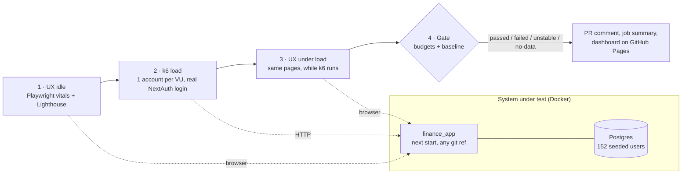

# finance-app-performance

[](https://github.com/BRLorena/finance-app-performance/actions/workflows/perf.yml)
[](https://brlorena.github.io/finance-app-performance/)

> Two-layer performance testing for [finance_app](https://github.com/BRLorena/finance_app) (Next.js, NextAuth, Prisma, Postgres). **k6** puts the server under load, **Playwright + Lighthouse** measure what a user sees while that load is running, and **one quality gate** turns both into a verdict that can block a pull request.

**📈 [Live dashboard](https://brlorena.github.io/finance-app-performance/)**: nightly load results, UX idle vs under load, Lighthouse scores and the weekly production smoke check.

---

## Why two layers

Playwright isn't a load testing tool. Each virtual user would be a real browser using hundreds of MB of RAM, so at around 100 users the test machine becomes the bottleneck instead of the app. Load testing and UX measurement answer different questions:

| Layer | Tool                    | Question                                              | Metrics                                                                   |
| ----- | ----------------------- | ----------------------------------------------------- | ------------------------------------------------------------------------- |
| Load  | k6                      | How does the **server** behave with N users at once?  | p95 latency per endpoint, error rate, throughput                          |
| UX    | Playwright + Lighthouse | What does **one user** experience while that happens? | LCP, CLS, TTFB, time until the dashboard's data arrives, Lighthouse score |

This project runs them **together**: the UX layer measures each page with the app idle, then again while k6 holds it at its target load, and reports how much the experience degraded. The reasoning and the alternatives (k6 browser, JMeter, Gatling, testing the Vercel URL) are in [ADR 001](docs/adr-001-load-vs-ux-tools.md).

---

## How a run works



1. **UX idle:** each page (login, dashboard) is loaded 5 times in a fresh browser context, and the medians are kept. Lighthouse audits both pages, the dashboard logged in.
2. **Load:** k6 runs the journey a user would: open the dashboard, fetch the summary, browse expenses and incomes, add an expense and delete it again. Every VU logs in through the real NextAuth credentials flow (CSRF token, credentials callback, session cookie) with **its own account**, because the app rate-limits per user.
3. **UX under load:** once k6 reaches its target load, the same UX measurements run again.
4. **Gate:** combines both layers into one verdict and compares it with the last passing run (see below).

### Load profiles

| Profile  | Shape                | Question                                      | Runs                        |
| -------- | -------------------- | --------------------------------------------- | --------------------------- |
| `smoke`  | 3 VUs, 50s           | Does the journey work at all?                 | Every PR and push to `main` |
| `load`   | 30 VUs for 3 minutes | Does it meet its budgets at expected traffic? | Nightly                     |
| `stress` | ramps up to 140 VUs  | Where does it start to degrade?               | Manual                      |
| `spike`  | 10 → 140 VUs in 10s  | Does it recover from a burst?                 | Manual                      |

A separate scenario checks the app's own protection: one user bursts `/api/summary` and must get `429` with the rate-limit headers once its 30 requests a minute are spent.

---

## The quality gate

[`gate/`](gate) is plain TypeScript: the logic does no I/O and is covered by [unit tests](gate/evaluate.test.ts).

- **Load budgets** are k6 thresholds (`p95` per endpoint, error rate, checks, no 429s), so `k6 run` fails on its own and the gate reports which threshold broke.
- **UX budgets** use Google's "good" Core Web Vitals (LCP ≤ 2.5s, CLS ≤ 0.1), plus a limit on how much slower the dashboard may get under load.
- **Baseline:** every metric is compared with the last **passing** run of the same target and profile. A metric regresses only when it's worse by more than 25% **and** by more than an absolute noise floor (100 ms for UX, 25 ms for endpoints), so shared CI runner noise doesn't fail builds. Failed runs never become the baseline.
- **Four verdicts:**

| Verdict    | Meaning                                                                                          |
| ---------- | ------------------------------------------------------------------------------------------------ |
| `passed`   | Every check ran and passed                                                                       |
| `failed`   | A budget was broken or a metric regressed                                                        |
| `unstable` | Nothing failed, but something wasn't measured (e.g. k6 crashed), so the run can't count as green |
| `no-data`  | Nothing ran                                                                                      |

The verdict is posted as a PR comment and the job summary. Each metric and its budget are explained in [docs/metrics.md](docs/metrics.md).

---

## Results

| Run                        | Result                                                                                                                                                                                                |
| -------------------------- | ----------------------------------------------------------------------------------------------------------------------------------------------------------------------------------------------------- |
| **Load** (30 VUs, 3 min)   | All budgets met. p95: summary 35 ms, lists 150–175 ms, login 502 ms (bcrypt). 0 errors, 0 rate-limited requests                                                                                       |
| **UX under load**          | Dashboard data arrives in 225 ms under load vs 212 ms idle (1.06x). Lighthouse 100 on both pages, idle and under load                                                                                 |
| **Stress** (up to 140 VUs) | Expense and income lists cross their 400 ms budget (p95 620–675 ms), and so does adding an expense (749 ms). The heavier `/api/summary` stays at 335 ms. The gate fails on exactly those three checks |
| **Rate limit**             | A 40-request burst gets 30 `200`s, then only `429`s, with `X-RateLimit-Limit: 30` and `X-RateLimit-Remaining: 0`                                                                                      |

These numbers come from a local run (Apple M1, app, database, k6 and Chromium on one machine), so treat them as a comparison between runs, not as capacity figures. The [dashboard](https://brlorena.github.io/finance-app-performance/) has the CI numbers over time.

**Findings for `finance_app`** (in [docs/limitations.md](docs/limitations.md)):

- The lists degrade before the summary does under stress. The summary runs 12 aggregate queries, so a likely place to look is how the list endpoints query and paginate. Not investigated yet.
- The rate limiter keeps its counters in each server instance's memory. On Vercel, each serverless instance counts separately, so the limit isn't enforced across instances.
- The login (credentials callback) has no rate limit. Only registration has one.

---

## Where load runs, and where it doesn't

Load **never** runs against the live Vercel app. CI builds `finance_app` from any git ref (`app_ref`), starts it with `next start` and its own Postgres in Docker, and seeds 152 users with 40 expenses, 12 incomes and 8 invoices each. A run there costs nothing, can be repeated, and can push as hard as needed.

Load testing the live URL would use up the free tiers of Vercel and Neon, measure Vercel's CDN instead of the app, run into the per-user rate limits, and write test data into production. Instead, the live app gets a **weekly, read-only smoke check**: 3 VUs for 50 seconds with one dedicated account, plus the UX measurements, with budgets scaled 3x for network distance and cold starts.

---

## CI

[`.github/workflows/perf.yml`](.github/workflows/perf.yml):

| Trigger                   | Target            | Profile                            | UX phases              |
| ------------------------- | ----------------- | ---------------------------------- | ---------------------- |
| Pull request to `main`    | local build       | `smoke`                            | idle                   |
| Push to `main`            | local build       | `smoke`                            | idle                   |
| Nightly (03:00 UTC)       | local build       | `load`                             | idle + under load      |
| Weekly (Monday 06:00 UTC) | Vercel, read-only | `smoke`                            | idle                   |
| Manual                    | either            | any profile, any `finance_app` ref | depends on the profile |

- The `finance_app` Docker image is built with the GitHub Actions layer cache, and Playwright's browsers are cached.
- Every run uploads its results (k6 summary, UX samples, Lighthouse HTML reports, verdict) as an artifact. The session cookie is excluded.
- Runs on `main` publish to [GitHub Pages](https://brlorena.github.io/finance-app-performance/): the run is appended to `history.json`, and a passing run becomes the new baseline. History lives on Pages, not in git.

---

## Running locally

Requirements: Node 22+, Docker, [k6](https://grafana.com/docs/k6/latest/set-up/install-k6/).

```bash
npm install
npx playwright install chromium

npm run app:up        # build finance_app (APP_REF=master by default) and start it on :3300
npm run seed          # 152 test users with data

npm run perf -- --profile smoke    # UX idle + k6 smoke + gate
npm run perf -- --profile load     # adds UX under load (about 5 min)
npm run load:rate-limit            # the 429 scenario

npm test              # gate unit tests
npm run check         # tsc (Node + k6), ESLint, Prettier
npm run app:down      # stop and delete the database
```

Results land in `results/`: `verdict.md`, `k6-summary.json`, `ux-*.json` and the Lighthouse HTML reports.

---

## Project structure

```
app/Dockerfile            Builds finance_app at any git ref, production mode
docker-compose.yml        The system under test: app + Postgres
config/users.ts           Test accounts shared by the seed, k6 and Playwright
scripts/
  seed.ts                 152 users with realistic data, straight into Postgres
  run.ts                  One full pass: UX idle → k6 → UX under load → gate
  publish.ts              History, baselines and dashboard for GitHub Pages
load/                     k6 (TypeScript)
  lib/auth.ts             NextAuth credentials login
  lib/profiles.ts         smoke / load / stress / spike
  scenarios/finance.ts    The user journey, with per-endpoint thresholds
  scenarios/rate-limit.ts The 429 behaviour
ux/                       Playwright
  lib/vitals.ts           LCP / CLS / TTFB / data ready from the browser
  vitals.spec.ts          5 cold samples per page, medians
  lighthouse.spec.ts      Lighthouse audits, dashboard logged in
gate/                     The verdict: pure logic + unit tests
dashboard/index.html      The GitHub Pages dashboard
docs/                     ADR, metrics glossary, limitations
```

---

## Credits

The two-layer idea and the `unstable` verdict were inspired by [praveenkumarbharthi/ui-performance-poc](https://github.com/praveenkumarbharthi/ui-performance-poc), which measures UX with one user alongside a separate JMeter load test. This project runs both layers together, against an app built from source, in GitHub Actions.

## Tech stack

- **Load:** k6 2.x (TypeScript scripts)
- **UX:** Playwright 1.64, Lighthouse 13
- **Gate:** TypeScript, Vitest
- **System under test:** finance_app (Next.js 16, NextAuth 5, Prisma 6), Postgres 17, Docker Compose
- **CI:** GitHub Actions, GitHub Pages (Chart.js dashboard)
